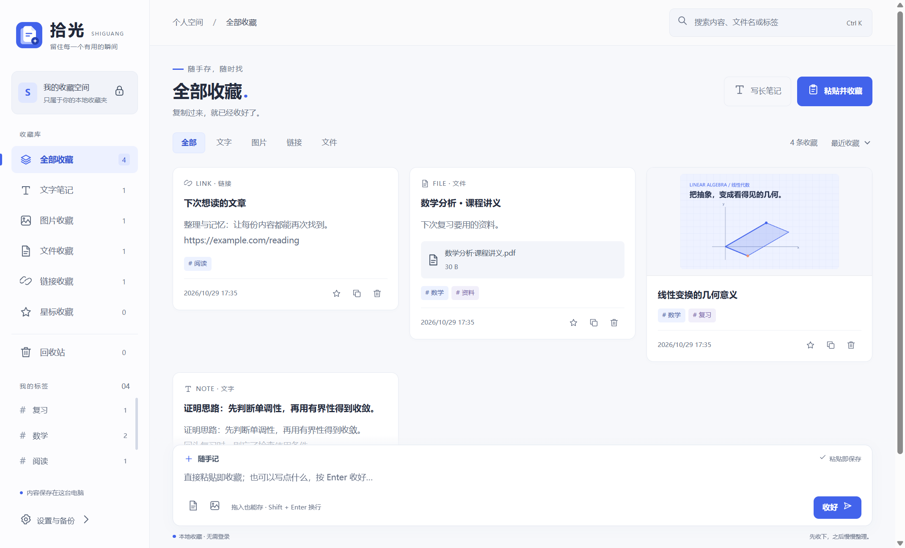

<p align="center">
  
</p>

<h1 align="center">拾光 · 随手一贴，即刻收藏</h1>

<p align="center">一个为文字、截图和文件准备的 Windows 本地收藏夹。</p>

看到有用的东西，你是不是也会先发给微信或 QQ 里的自己？时间一久，文字、截图和 PDF 混在聊天记录中，想用时又翻不到。

拾光保留复制粘贴的顺手：打开程序，直接按 **Ctrl + V** 就能收藏，自动记录时间。先收好，再慢慢整理。



## 能做什么

- **粘贴即收藏**：文字、截图、复制的文件直接保存；也可拖入图片、PDF、Office 文档等文件。
- **随手记**：输入文字后按 Enter 保存，Shift + Enter 换行；无需先建笔记、填标题或选分类。
- **从其他程序收藏**：拾光运行时，按 Ctrl + Alt + S 唤起程序并收藏剪贴板内容。
- **找回内容**：按标题、正文、标签、文件名和收藏日期搜索，配合星标与类型筛选。
- **保留完整图片**：缩略图保持原比例，点击查看大图。
- **自动记时**：保存收藏时间和修改时间，编辑内容不会改变最初的收藏时间。
- **本地数据**：无需账号，附件复制进收藏库；支持更换保存位置、导出和合并导入 ZIP 备份。
- **轻量托盘**：关闭窗口后驻留托盘；可开启登录后延迟约 45 秒启动轻量托盘，主界面按需加载。

搜索目前不识别图片或 PDF 中的文字。程序没有云同步，也不会自动导入微信或 QQ 的聊天记录。

## 下载与使用

在 [Releases](https://github.com/sky271801/shiguang-desktop/releases) 查看发布的版本。

Windows 程序需要保留完整文件夹，启动其中的 **拾光.exe**；轻量托盘依赖同目录的 **拾光托盘.exe**。运行打包版本不需要安装 Node.js。

默认收藏库位置为 `%APPDATA%/Shiguang/collection`，可在「设置与备份」中更换。建议定期导出备份。

详细说明见 [使用说明](使用说明.md)。

## 本地开发

桌面程序使用 Electron、原生 HTML / CSS / JavaScript，数据保存在本机。建议使用 Node.js 22 或更新版本。

```bash
npm ci
npm start
```

运行已有检查：

```bash
npm test
npm run test:e2e
```

在 Windows 上构建：

```bash
npm run build
```

输出目录为 `release/<版本号>/win-unpacked/`。构建轻量托盘需要 Windows 自带的 .NET Framework C# 编译器，构建脚本使用 `%WINDIR%/Microsoft.NET/Framework64/v4.0.30319/csc.exe`。

## 宣传片工程

[shiguang-promo](shiguang-promo/) 是配套的 Remotion 工程：40 秒、1920×1080 横屏、60fps，音乐与字幕，无旁白。开头演绎给微信里的自己发消息，接着展示内容堆积、找不到资料，以及使用拾光粘贴收藏和搜索找回的过程。

```bash
cd shiguang-promo
npm ci
npm run dev -- --port=3016
```

启动后打开 `http://localhost:3016/Shiguang`。七个场景可分别调整标题、说明和时间线。程序截图来自隔离的示例收藏库；聊天界面为场景演绎，音乐为项目自制器乐。

## 项目结构

| 路径 | 内容 |
| --- | --- |
| `main.js` / `preload.js` | Electron 窗口、托盘、剪贴板与界面通信 |
| `store.js` / `storage-manager.js` | 收藏、附件、备份与保存位置迁移 |
| `startup.js` / `assets/LightTray.cs` | Windows 延迟自启动与轻量托盘 |
| `ui/` | 桌面界面与交互 |
| `tests/` | 存储、迁移和真实界面检查 |
| `scripts/` | 构建和启动设置工具 |
| `shiguang-promo/` | 宣传片源代码、示例图片与原创音乐 |

本地收藏、备份、依赖、测试截图和生成的成片不提交到代码仓库。
